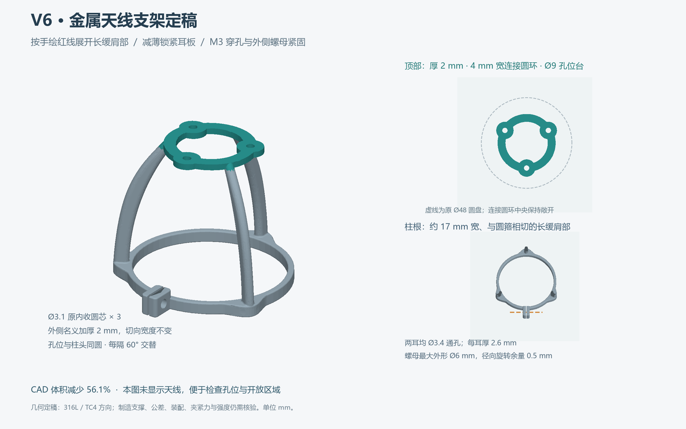
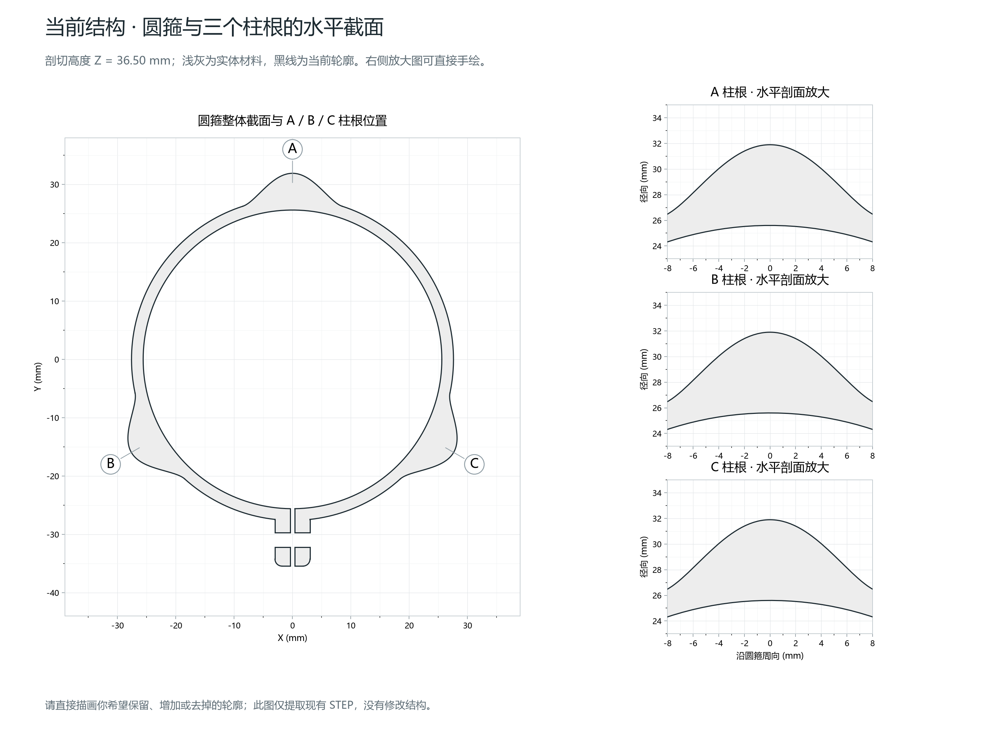
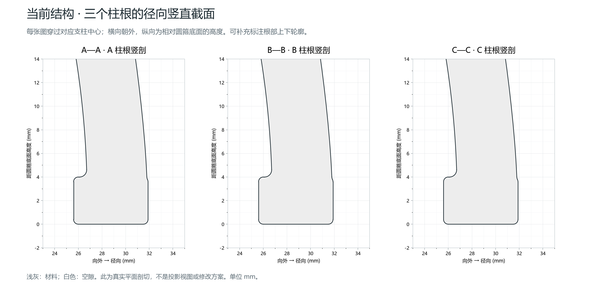
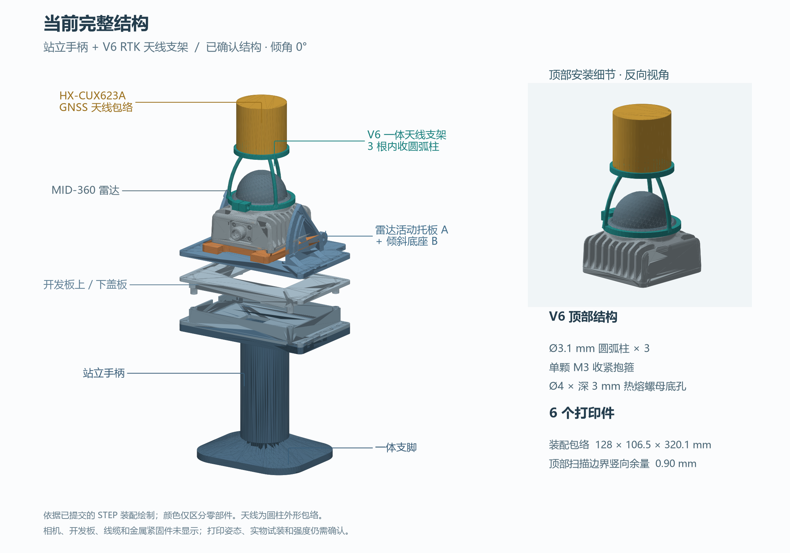
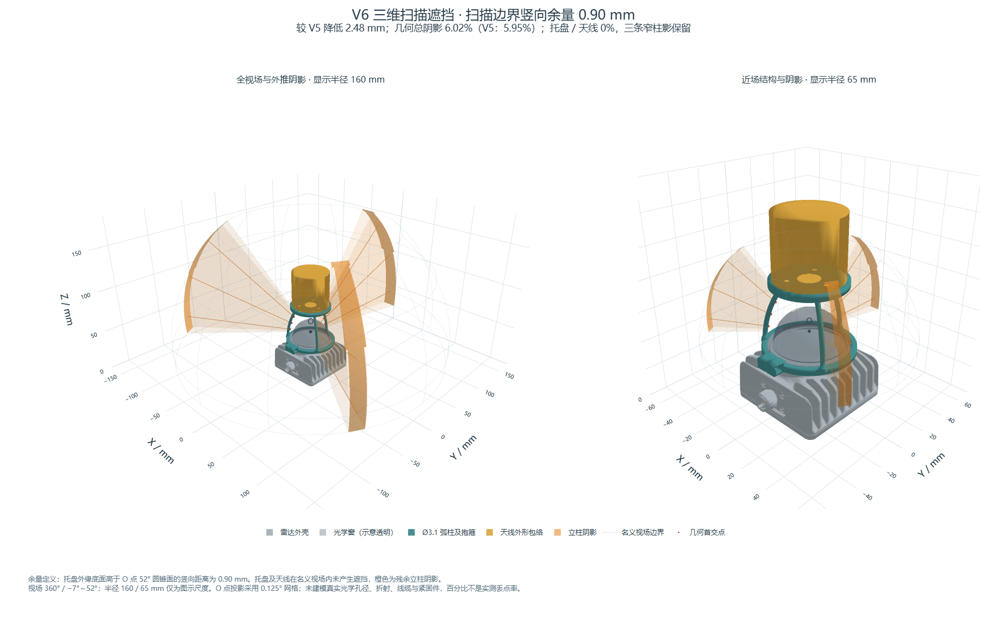

# V6 RTK 天线支架（当前金属版已定稿）

2026-10-28 用户确认采用 V6。用于在 MID-360 顶部安装 HARXON HX-CUX623A。
本次将已选定结构及其复现、验证材料从审阅导出区纳入现有仓库目录；结构仍待实物试装和强度验证。

## V6 金属打印版（2026-11-15）

用户于 2026-11-15 确认当前金属版几何定稿，候选材料为 316L / TC4，保留原 V6。顶部三个孔位以圆环相连，柱根沿圆箍平滑加宽，底部抱箍减薄，收紧孔采用紧凑布局并保留螺母旋转空间。



| 项目 | 本版尺寸 / 做法 |
| --- | --- |
| 顶部 | 2 mm 厚，4 mm 宽连接圆环，三个 Ø9 孔位台；保留 Ø3 通孔、23 mm 等边三角孔距及 V6 安装面高度 |
| 顶部排列 | 三孔与三柱头共用 Ø26.5581 分布圆，每隔 60° 交替；孔为 30/150/270°，柱为 90/210/330°，取消偏置短筋 |
| 抱箍 | 内径 Ø51.2；一般区域径向壁厚由 3.5 减至 2 mm；边缘 R0.4，耳板平面转角 R1.2 |
| 三处柱根 | 按手绘红线制作约 17 mm 宽的长缓肩部，两端与圆箍相切；肩部上方与支柱接合处 R0.6，柱脚底边 R0.4 |
| 外侧加强材料 | 保留原 Ø3.1 圆芯，在其外侧名义加厚 2 mm；切向宽度保持 3.1，靠近顶部的加强材料逐渐减薄，中心线不向外弯 |
| 收紧孔 | Y=-30.94，Z=37.65，沿 X 贯穿两耳；较上一版再向圆箍靠近 2.31 mm，尾端同步缩至 Y=-35.44 |
| 两侧耳板 | 均为 Ø3.4 通孔，每耳厚 2.6 mm、高 7 mm；M3 螺栓穿过，外侧独立螺母锁紧，无需攻牙 |
| 螺母旋转空间 | 按用户给定的最大外形 Ø6 mm，径向各留 0.5 mm，采用 Ø7 mm 旋转包络；螺母对后侧名义圆箍的间隙约 0.50 mm |

交付入口：

- **最终导出单件**：[rtk_antenna_mount_metal_final.step](exports/rtk_antenna_mount_metal_final.step)，单位 mm，一个有效实体，保留装配坐标。
- [生成器输出单件](step/rtk_antenna_mount_v6_metal.step)与[最终导出核验记录](reports/rtk_metal_final_export_20261115.json)
- [金属版整机装配 STEP](step/standing_device_with_rtk_v6_metal.step)
- [离线旋转查看器](renders/rtk_antenna_mount_v6_metal.html)
- [参数与实体/装配/光学核验报告](reports/rtk_mount_v6_metal_20261115.json)
- [给加工方的孔位说明](reports/rtk_v6_metal_manufacturing_20261115.md)

定稿截面：





金属版与原内收对称锥脚版使用相同中心投影协议比较，当前 0.5/0.25/0.125° 三档结果及新增被挡射线统计见[几何报告](reports/rtk_mount_v6_metal_20261115.json)。结论限于当前模型与采样射线，不代表实测丢点率或所有连续光线方向的证明。

本版所有打印孔均**不攻牙**。抱箍两耳统一 Ø3.4 通孔，使用 M3 螺栓和外侧独立螺母；顶部三个天线孔仍为 Ø3 通孔。顶部减薄后，应重新确认原天线螺钉长度，避免顶到天线孔底。

复现使用现有 `requirements_rtk.txt` 环境，运行 `python scripts/build_rtk_metal.py`。入口会输出单件、装配、预览、离线查看器及报告，执行 STEP 回读、雷达和天线包络干涉、工具通道、安装路径抽样、0/20/40° 与 B 件的干涉。遮挡使用 0.5/0.25/0.125° 三档网格，与保存的对称锥脚版 `tests/rtk_mount_metal_cone_baseline_20261115.step` 同时计算，并检查总遮挡及新增被挡射线。完整结构载荷、夹紧柔顺性、螺纹强度、金属反光和 RF 影响未验证；夹紧内径、实际打印补偿和支撑由供应商确认。

以下继续记录原先选定的 V6 打印结构。





## 先看这些文件

| 文件 | 用途 |
| --- | --- |
| [独立支架 STEP](step/rtk_antenna_mount_v6.step) | 已选定的一体打印件；保留雷达装配坐标，切片前需调整摆放 |
| [站立手柄整机 STEP](step/standing_device_with_rtk_v6.step) | 5 个原结构打印件、V6 支架、官方雷达 CAD 和圆柱天线包络；不含相机、PCB、线缆及紧固件实体 |
| [交互三维遮挡 HTML](renders/rtk_scan_occlusion_3d_v6_20261028.html) | 下载后用浏览器打开，可离线旋转、缩放及隐藏图层 |
| [参数快照](reports/rtk_mount_v6_parameters.json) | 完整尺寸；参数修改入口为 `scripts/build_rtk_mount.py` 中的 `PARAMS` |
| [几何报告](reports/rtk_mount_review_v6_20261028.json) | 实体、孔位、基线差异及干涉检查 |
| [遮挡报告](reports/rtk_scan_occlusion_v6_20261028.json) | 三档独立网格、精确 52° 边界、立体角加权及方法限制 |
| [三维图数据报告](reports/rtk_shadow_3d_v6_20261028.json) | 模型指纹、显示网格与分析数据一致性 |
| [选版记录](reports/rtk_mount_v6_selection.json) | 用户选版、关键文件及原审阅件来源指纹 |

## 已确认的尺寸和验证范围

| 项目 | V6 |
| --- | --- |
| 抱箍 | 候选金属带 Ø51；抱箍内 Ø51.2、径向壁厚 3.5、接触高 4、开口 0.8 |
| 抱箍紧固 | 1 颗 M3；通孔 Ø3.4；右耳热熔螺母底孔 Ø4 × 深 3，直接沿用 A 件参数 |
| 立柱 | 3 根内收圆弧，主体 Ø3.1；底部锚点半径 28.3，顶部半径 11，固定底端竖直切线 |
| 顶托盘 | Ø48、厚 4、中央开口 Ø14 |
| 天线三孔 | 用户提供的边长 23 等边三角形；托盘 Ø3 通孔；天线官方螺纹 #3-48 UNC |
| 托盘外缘扫描边界余量 | **0.90 mm（竖向）**，不是托盘到玻璃罩的距离 |
| 天线安装面高于玻璃罩顶点 | 22.5215 mm，比 V5 降低 2.4785 mm |
| 16.5 mm 弯头与玻璃顶点的名义竖向余量 | 6.0215 mm；弯头实体及线缆弯曲尚未建模 |
| 托盘外缘最低投影仰角 | 52.7998°，高于名义 52° 上边界 |
| 新增件几何遮挡立体角占比 | 6.0191%，三个柱影仍存在；托盘及天线包络无命中 |

坐标以雷达底安装面为 Z=0，连接器朝 −Y。整机恢复到开发板坐标时，雷达平移 Y=−5、Z=73.1522。
支架为一个有效实体；名义 CAD 与雷达无体积交叠，安装轴向高度抽样以及 0° / 20° / 40° 俯仰检查通过。

遮挡从手册 O 点 `[0, 0, 47]` 作中心投影，视场为 360°、−7°～52°，用 0.5° / 0.25° / 0.125° 独立网格，并按立体角加权；另测精确 52° 上边界。
**6.02% 是几何估算，不是实测丢点率。** O 点不是已验证的真实光学出射孔径；折射、光束发散、扫描驻留、线缆、弯头和紧固件未计入。
托盘无命中不代表整个上部视场完全无遮挡，三根立柱仍遮挡窄扇区。
0.9 mm 名义余量、弹性开口、夹持力、蠕变和强度均需实物验证。Livox 手册不允许雷达承载额外载荷，这个夹持面不是厂家认可的承载接口。

## 复现

安装 [requirements_rtk.txt](requirements_rtk.txt)；这是独立 OCP 入口，不依赖本机临时目录，不要求 FreeCAD。
官方 CAD 不重复提交，放到已有约定路径 `vendor/livox/mid-360-asm.stp`。Linux 可用现有 `bash scripts/fetch_mid360.sh`。
Windows PowerShell 可在已有 `vendor/livox/` 目录下载：

```powershell
Invoke-WebRequest -Uri 'https://terra-1-g.djicdn.com/65c028cd298f4669a7f0e40e50ba1131/Mid360/mid-360-asm.stp' -OutFile 'vendor/livox/mid-360-asm.stp'
Get-FileHash 'vendor/livox/mid-360-asm.stp' -Algorithm SHA256
```

预期 SHA-256：`b93e9b51282ed319b6aa755e76a132c0eb03306da5f3b9676bcabf2e2ae25f02`，生成器会校验。
重新生成会覆盖下述 V6 STEP、参数、报告及 HTML：

```text
python -m pip install -r requirements_rtk.txt
python scripts/build_rtk_mount.py
python scripts/analyze_rtk_occlusion.py
python scripts/render_rtk_shadow_3d.py
python scripts/render_current_structure.py
```

生成器和分析器保留真实孔位、单实体、STEP 回读、无干涉、固定底部与收敛网格等断言。
分析将 V5 / V6 射线数据保存为 `reports/rtk_mount_v6_angular_shadow.npz`；绘图会重新计算显示数据对应的指标并核对当前 STEP 指纹，防止图与报告错配。
`tests/rtk_mount_baseline_v2.step`、`tests/rtk_mount_baseline_v5.step` 和 V5 参数仅用于底部不变及遮挡对照，不作为可选打印版本。
原始 `exports/` 中的历史文件不再是这些脚本的依赖。

如需重新导出 PNG，在已安装 Playwright 的 Node 环境中运行 `node scripts/verify_rtk_viewer.cjs`。
默认使用 Playwright Chromium；`PLAYWRIGHT_BROWSER_PATH` 可指定现有 Edge / Chrome。
该脚本检查两个三维画布、页面错误并旋转视角，将 PNG 和浏览器报告写回现有 `renders/`、`reports/`。
截图后的完整一致性检查：

```text
python -m pytest -p no:cacheprovider tests/test_rtk_mount_selection.py
```

这套独立入口尚未纳入原 FreeCAD 标准打印排版与完整相机 / 板卡干涉流程；使用独立 STEP 前需在切片软件确认姿态与支撑。

## 定稿清理与历史归档

`exports/` 当前只保留金属天线支架最终单件 STEP。旧版审阅目录、重复 ZIP、试验 STEP、过渡图表、临时日志和过程计划已移到仓库外同级目录 `Motion-Structure-archive/20261115-metal-final/`，归档清单记录了各文件的 SHA-256。

仓库保留当前金属单件、整机、复现代码、参数与核验报告、预览和截面图。原 V6 定稿及测试所需的历史基线继续保留；官方 CAD 输入和参考资料不属于本次清理范围。

来源：[Livox 规格](https://www.livoxtech.com/mid-360/specs)、[Livox 手册](https://terra-1-g.djicdn.com/851d20f7b9f64838a34cd02351370894/Livox/Livox_Mid-360_User_Manual_EN.pdf)、[Harxon 官方天线](https://www.harxon.com/product/detail/2)。天线三孔间距和弯头高度来自用户输入，尚未获得对应厂家机械图复核。
